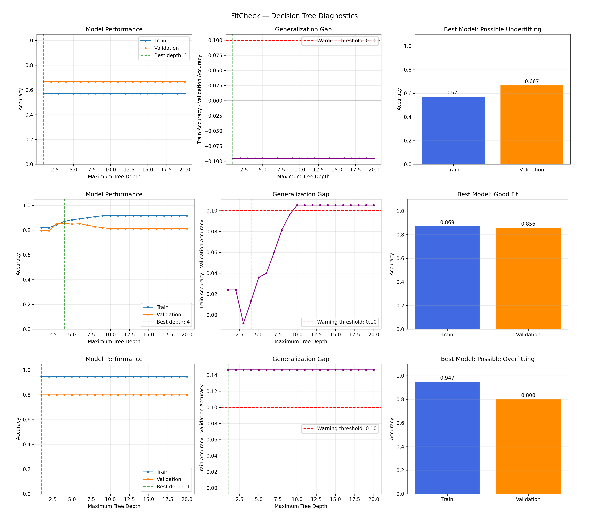
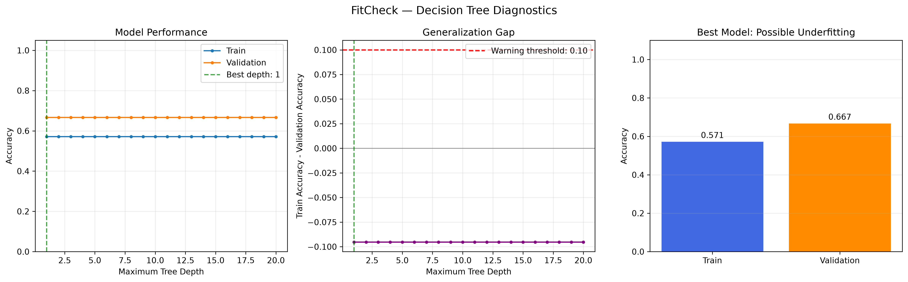
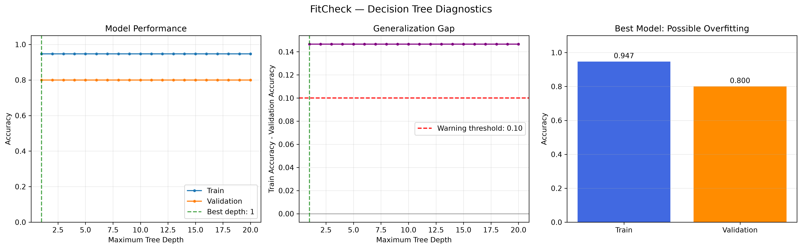
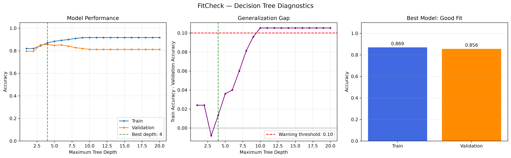

# FitCheck — ML Model Fit Diagnostics

A Python project for analyzing underfitting, overfitting, and generalization using Decision Tree classifiers.

---

## Author

**Naeim Mousavi**

GitHub: [@nmousavi2020](https://github.com/nmousavi2020)

Copyright (c) 2026 N. Mousavi.

---

## Overview

This project evaluates how model complexity and dataset size affect machine learning performance and generalization.

The workflow is:

```text
Dataset
       ↓
Train / Validation Split
       ↓
Decision Tree — Varying Depths
       ↓
Training Accuracy
       ↓
Validation Accuracy
       ↓
Generalization Gap
       ↓
Fit Diagnosis
       ↓
CSV + JSON + Diagnostic Plots
```

---

## Features

- Training and validation accuracy analysis
- Generalization gap calculation
- Underfitting and overfitting diagnostics
- Visual comparison of three fitting scenarios
- CSV statistics and JSON summary reports

---

## Project Structure

```text
FitCheck/
│
├── results/
│   ├── compare_cases.png
│   ├── Underfittingn_samples=10.png
│   ├── Overfitting_n_samples=100.png
│   ├── Goodfit_n_samples=1000.png
│   ├── diagnostics.png
│   ├── statistics.csv
│   └── summary.json
│
├── fitcheck.py
├── requirements.txt
├── README.md
├── LICENSE
└── .gitignore
```

---

## Method

### 1. Dataset

FitCheck evaluates model performance using datasets with different sample sizes.

```text
10 Samples      → Underfitting Example
100 Samples     → Overfitting Example
1000 Samples    → Good-Fit Example
```

These are illustrative scenarios. Actual results depend on the dataset, model configuration, and validation split.

### 2. Decision Tree Classifier

A Decision Tree classifier is trained at different maximum depths to analyze how model complexity affects performance.

### 3. Training Accuracy

Training accuracy measures how well the model predicts samples in the training dataset.

### 4. Validation Accuracy

Validation accuracy measures how well the model predicts samples in the held-out validation dataset.

### 5. Generalization Gap

The generalization gap is calculated as:

```text
Generalization Gap =
Training Accuracy - Validation Accuracy
```

A large positive gap may indicate overfitting, while low training and validation accuracy may indicate underfitting.

### 6. Fit Diagnosis

Configurable thresholds are used to flag potential fitting problems.

These diagnoses are heuristic indicators, not definitive proof of underfitting or overfitting.

---

## Output

After execution, the project generates diagnostic figures and reports:

```text
results/
├── compare_cases.png
├── Underfittingn_samples=10.png
├── Overfitting_n_samples=100.png
├── Goodfit_n_samples=1000.png
├── diagnostics.png
├── statistics.csv
└── summary.json
```

---

## Diagnostic Results

### Comparison of All Cases

The following figure compares underfitting, overfitting, and good-fit scenarios.



### 1. Underfitting

Underfitting occurs when a model is too simple to learn the underlying patterns. Training and validation accuracy may both be low.



Example: Dataset containing 10 samples.

### 2. Overfitting

Overfitting occurs when a model performs well on training data but generalizes poorly to unseen data.



Example: Dataset containing 100 samples.

### 3. Good Fit

A good fit generally combines satisfactory training and validation performance with a relatively small generalization gap.



Example: Dataset containing 1,000 samples.

---

## Statistics and Reports

FitCheck generates structured outputs for further analysis.

```text
results/
├── statistics.csv
└── summary.json
```

- **statistics.csv:** Contains metrics for every tested tree depth.
- **summary.json:** Contains the selected model and diagnostic summary.

---

## Installation

Requires Python 3.10 or later.

Install the required dependencies:

```bash
pip install -r requirements.txt
```

---

## Run

From the project root:

```bash
python fitcheck.py
```

The program evaluates the configured Decision Tree models and saves generated reports and diagnostic plots in the `results/` directory.

---

## Visualization

The diagnostic figures illustrate three possible fitting scenarios.

```text
Underfitting
Training Accuracy   → Low
Validation Accuracy → Low

Overfitting
Training Accuracy   → High
Validation Accuracy → Lower
Generalization Gap  → Large

Good Fit
Training Accuracy   → Satisfactory
Validation Accuracy → Satisfactory
Generalization Gap  → Relatively Small
```

The figures are also included directly in this README.


---

## Limitations

- Small datasets can produce unreliable validation estimates.
- A single train-validation split may be unstable.
- Decision Tree performance depends on model configuration and dataset characteristics.
- Threshold-based diagnoses are heuristic.
- A small generalization gap does not guarantee good predictive performance.
- Cross-validation and a separate test set are recommended for more reliable evaluation.

---

## Next Step

The next development step is to improve the evaluation workflow:

```text
Dataset
       ↓
Data Validation
       ↓
Feature Engineering
       ↓
Train / Validation Split
       ↓
Model Training
       ↓
Cross-Validation
       ↓
Model Evaluation
       ↓
Diagnostic Reports
```

This will make FitCheck more robust and support the evaluation of additional machine learning models.

---

## License

This project is licensed under the MIT License.

See the [LICENSE](LICENSE) file for details.

---
